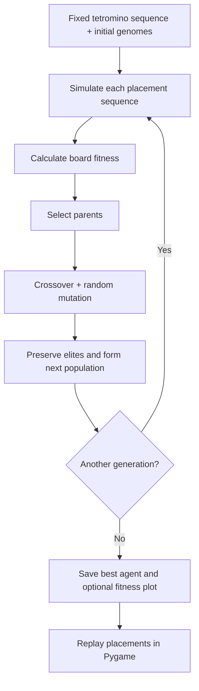

# Tetris AI — Evolving a Placement Agent

> **Project 06 · Artificial Intelligence Portfolio**  
> Genetic algorithms · Python · Tetris simulation · Pygame visualization

A genetic algorithm searches for a sequence of **(rotation, horizontal position)** decisions that performs well on a fixed sequence of Tetris pieces. Each candidate agent is evaluated by a simplified board simulator; stronger candidates are selected, crossed over, and mutated across generations.

**[Back to the AI portfolio](../README.md)** · **[Original project](https://github.com/Parand1khalili/Tetris-Genetic-Algorithm)**

## At a glance

| Component | What it does |
| --- | --- |
| Genome | One `(rotation, x)` placement for each piece in `tetris_evolution/data/shape_sequence.txt` |
| Fitness | Rewards complete rows and penalizes unfavorable board geometry (including stack height, wells, and bumpiness) |
| Selection | Tournament selection (default) or roulette-wheel selection |
| Crossover | Single-point (default) or uniform crossover |
| Mutation | Random replacement of individual placement genes |
| Elitism | Retains selected high-fitness candidates between generations |
| Visualization | Replays a saved placement sequence using Pygame |

**Scope:** this is a fixed-piece-sequence optimization assignment, not a complete playable Tetris implementation. In particular, the simulator scores complete rows but does **not** implement standard line clearing.

## How the agent learns



### Example output


*An existing fitness-evolution plot from the [original repository](https://github.com/Parand1khalili/Tetris-Genetic-Algorithm/blob/main/fitness_evolution.png). This illustrates a run; it is not a comparative performance benchmark.*

## Run it

From the **Fundamentals-of-AI** repository root:

```bash
cd 06-Tetris-Genetic-Algorithm
python -m pip install -r requirements.txt
python tetris_evolution/run_evolution.py --generations 3 --population 10 --elitism 2 --output demo_agent.txt --plot
```

The training command starts with a stored agent from `hold.txt` and writes `demo_agent.txt` and a fresh `fitness_evolution.png` in the **current working directory**. Using a different `--output` name protects the included `best_agent.txt`.

To visualize the **included** saved agent in a desktop environment:

```bash
python tetris_evolution/visualize_agent.py
```

Close the Pygame window to exit. Visualization requires a graphical desktop; it is not intended for a headless server.

### Options worth exploring

```bash
python tetris_evolution/run_evolution.py --help
```

You can adjust the number of generations, population size, elitism, mutation rate, parent selection, and crossover operator. The default **tournament selection** is the documented starting path; the alternative roulette selector has not been independently validated for the current scoring function.

## Code map

| Location | Responsibility |
| --- | --- |
| `tetris_evolution/tetris/game.py` | Board simulation and fitness calculation |
| `tetris_evolution/tetris/agent.py` | Genome, evaluation, and loading/saving placements |
| `tetris_evolution/tetris/constants.py` | Tetromino definitions and fixed shape sequence |
| `tetris_evolution/evolution/algorithm.py` | Genetic algorithm interfaces |
| `tetris_evolution/evolution/implementation.py` | Implemented selection, crossover, mutation, and evolution |
| `tetris_evolution/run_evolution.py` | Training CLI |
| `tetris_evolution/visualize_agent.py` | Saved-agent visualization CLI |
| `best_agent.txt`, `hold.txt`, `parand.txt` | Preserved placement files from the original project |

**Provenance:** code and placement data were copied without rewriting the algorithms from the [original Tetris repository](https://github.com/Parand1khalili/Tetris-Genetic-Algorithm). Generated `__pycache__` files were intentionally excluded. The original repository remains available with its history.

## Notes and limitations

- Fitness reflects the implemented heuristic, not a standardized Tetris score or a generalization test over unseen shape sequences.
- The source code uses `pkg_resources`; `setuptools` is included as a runtime dependency.
- No new training results are claimed by this README. Repeat runs to validate behavior in your own environment.
