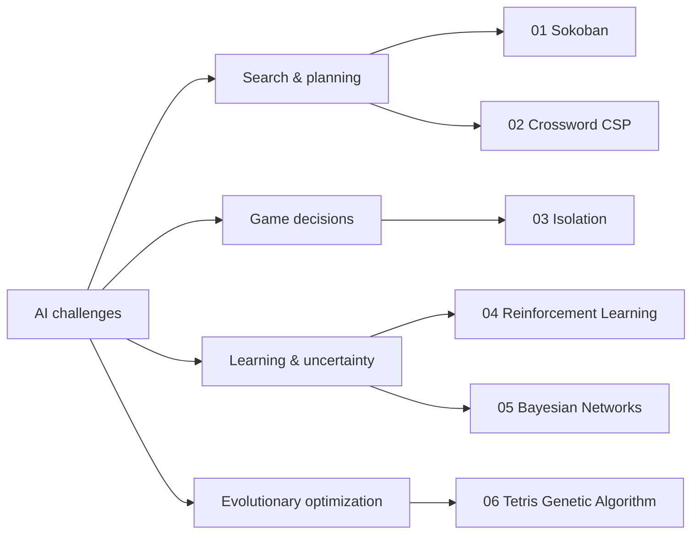

# Fundamentals of Artificial Intelligence

**Six hands-on AI projects** developed as part of Computer Engineering coursework at **Amirkabir University of Technology (Tehran Polytechnic)**. Explore search, constraint solving, adversarial decision making, reinforcement learning, probabilistic inference, and evolutionary optimization.

| # | Project | Main ideas | Artifact |
| :--: | --- | --- | --- |
| 01 | [Sokoban AI Solver](./01-Sokoban-AI-Solver/) | BFS, DFS, UCS, Greedy, A*, deadlock-aware heuristics | [Screenshot](./01-Sokoban-AI-Solver/screenshot.png) |
| 02 | [Crossword CSP Solver](./02-Crossword-CSP-Solver/) | AC-3, backtracking, MRV, degree heuristic, LCV | [README](./02-Crossword-CSP-Solver/README.md) |
| 03 | [Isolation Game Agent](./03-Isolation-Game-Agent/) | Minimax, alpha-beta pruning, iterative deepening | [Demo GIF](./03-Isolation-Game-Agent/viz.gif) |
| 04 | [RL LunarLander & MDP](./04-RL-LunarLander/) | Q-learning, value iteration, policy iteration | [Learning curve](./04-RL-LunarLander/learning_curve.png) |
| 05 | [Bayesian Networks](./05-Bayesian-Networks/) | Variable elimination, likelihood weighting, Gibbs sampling | [README](./05-Bayesian-Networks/README.md) |
| 06 | [Tetris Genetic Algorithm](./06-Tetris-Genetic-Algorithm/) | Evolutionary optimization of placement decisions | [Process & result](./06-Tetris-Genetic-Algorithm/README.md) |

## Find the algorithm you want to explore



## Getting started

Clone the portfolio and install the common project dependencies:

```bash
git clone https://github.com/Parand1khalili/Fundamentals-of-AI.git
cd Fundamentals-of-AI
python -m pip install -r requirements.txt
```

**Each project has its own entry point and instructions.** Follow the linked project README rather than assuming every folder contains a `main.py`.

### Tetris quick start

```bash
cd 06-Tetris-Genetic-Algorithm
python -m pip install -r requirements.txt
python tetris_evolution/run_evolution.py --generations 3 --population 10 --elitism 2 --output demo_agent.txt --plot
```

See the [Tetris project documentation](./06-Tetris-Genetic-Algorithm/README.md) for a step-by-step workflow, an existing output plot, visualization, and limitations.

---

**Author:** [Parand Khalili](https://github.com/Parand1khalili) · [Portfolio](https://parand1khalili.github.io/)

The Tetris source is also preserved in its [original repository](https://github.com/Parand1khalili/Tetris-Genetic-Algorithm). Where projects incorporate starter code or third-party material, consult each project's files for attribution and licensing.
